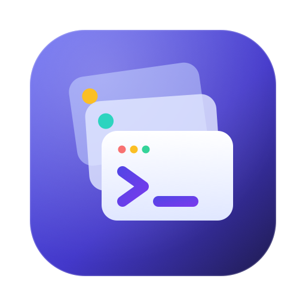
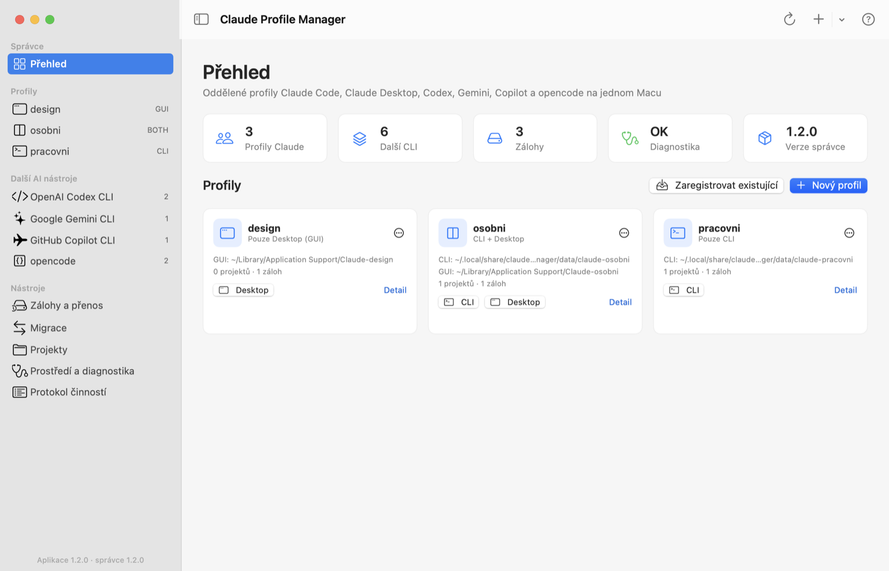
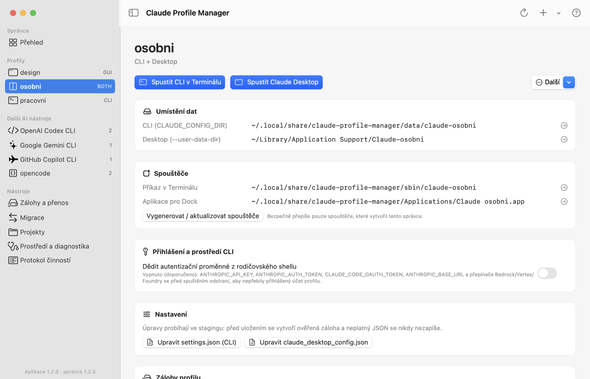
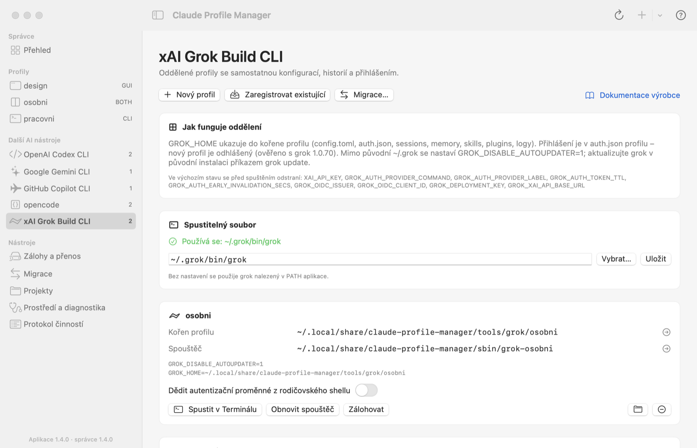
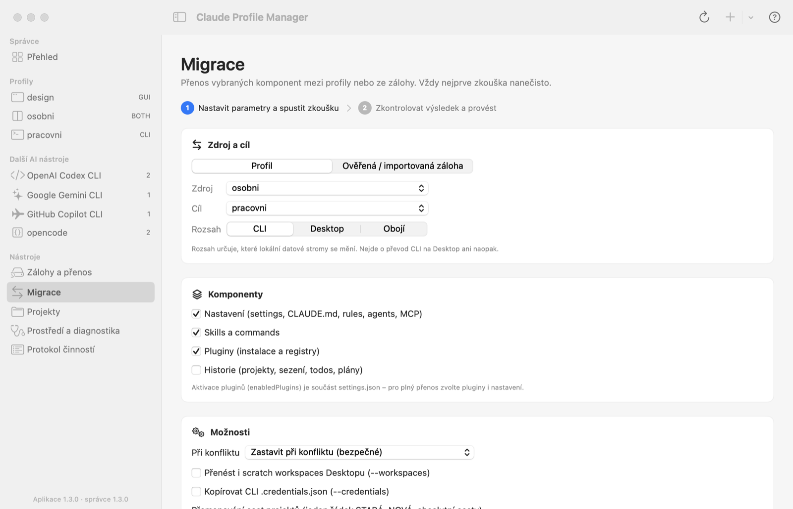
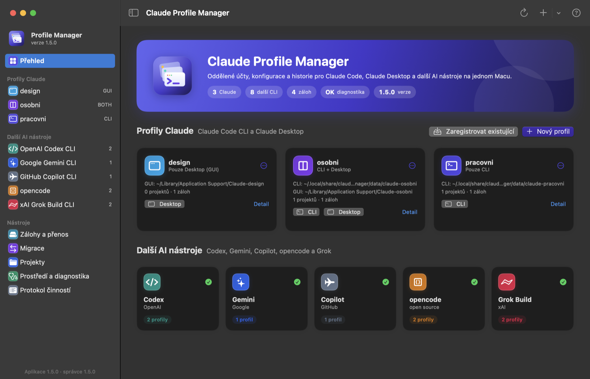

<p align="center">
  
</p>

<h1 align="center">Claude Profile Manager</h1>

<p align="center">
  Separate, safely managed profiles for <b>Claude Code</b>, <b>Claude Desktop</b> and other AI coding CLIs on one Mac.
</p>

<p align="center">
  <a href="https://github.com/m5ike/claude-profile-manager/releases/latest"></a>
  
  
  
</p>

<p align="center">
  <a href="#installation">Installation</a> ·
  <a href="#quick-start">Quick start</a> ·
  <a href="#the-macos-app">macOS app</a> ·
  <a href="#command-reference">Commands</a> ·
  <a href="#safety-model">Safety model</a> ·
  <a href="docs/Napoveda.pdf">User manual (CZ, PDF)</a> ·
  <a href="README.cs.md">Česky</a>
</p>

---

Claude Profile Manager lets you keep several fully separated environments — for example a personal and a work account — each with its own login, configuration, history, skills and plugins. It is a single dependency-free Python script (`claude-manager.py`) with an interactive terminal menu, plus an optional native macOS app that drives the same script.

<p align="center">
  
</p>

## Contents

- [Features](#features)
- [Supported tools](#supported-tools)
- [Installation](#installation)
- [Quick start](#quick-start)
- [The macOS app](#the-macos-app)
- [Everyday use](#everyday-use)
- [Backups, migration and moving to another Mac](#backups-migration-and-moving-to-another-mac)
- [Other AI CLIs](#other-ai-clis)
- [Command reference](#command-reference)
- [Safety model](#safety-model)
- [Limitations](#limitations)
- [Building from source](#building-from-source)
- [Testing](#testing)
- [Project layout](#project-layout)
- [Documentation and changelog](#documentation-and-changelog)
- [License](#license)

## Features

- **Profiles per account** – CLI-only, Desktop-only or combined profiles for Claude Code and Claude Desktop.
- **Launchers** – a `claude-NAME` command for the terminal and a `Claude NAME.app` for the Dock; CLI launches pass arguments, stdin/stdout/stderr, TTY, signals and exit code through unchanged (`execve`).
- **Account isolation** – inherited API keys and provider switches (`ANTHROPIC_API_KEY`, `ANTHROPIC_AUTH_TOKEN`, …) are removed before launch, so they cannot silently override the profile's login; opt in per profile if you want them.
- **Verified backups** – per-file SHA-256 inventories, exact restore with an automatic pre-restore backup, portable `.tar.gz` export and hardened import.
- **Migration with dry-run** – copy settings, skills, plugins and history between profiles or from a backup; conflicts stop the operation unless you choose `keep` or `replace`.
- **Project copy** – duplicate a Git project (including uncommitted files) for another profile, refusing linked worktrees, submodules and external links.
- **Transactions and recovery** – data changes are staged, journaled and switched atomically per root; an interrupted run is recovered with `recover`.
- **Other AI CLIs** – the same isolation, launchers, backups and migration for OpenAI Codex CLI, Google Gemini CLI, GitHub Copilot CLI, opencode and xAI Grok Build CLI.
- **Native macOS app** – SwiftUI front-end with dry-run → apply flows, a JSON settings editor, an activity log of every executed command, light and dark mode.

## Supported tools

| Tool | How a profile is isolated | Notes |
| --- | --- | --- |
| **Claude Code CLI** | `CLAUDE_CONFIG_DIR` | Documented override for config, projects and plugins. |
| **Claude Desktop** | `--user-data-dir` (+ `CLAUDE_CONFIG_DIR` for combined profiles) | Not a stable public API; see [Limitations](#limitations). |
| **OpenAI Codex CLI** | `CODEX_HOME` | New profiles get `cli_auth_credentials_store = "file"` so the login stays in the profile. |
| **Google Gemini CLI** | `GEMINI_CLI_HOME` (uses `.gemini` inside) | Google-account login may live in the shared macOS keychain. |
| **GitHub Copilot CLI** | `COPILOT_HOME`, `COPILOT_CACHE_HOME` | OAuth token is in the keychain per account; `/login` once per profile. |
| **opencode** | `XDG_CONFIG_HOME`, `XDG_DATA_HOME`, `XDG_STATE_HOME`, `XDG_CACHE_HOME` | Verified with `opencode debug paths`; XDG vars are inherited by tools opencode starts. |
| **xAI Grok Build CLI** | `GROK_HOME` (+ `GROK_DISABLE_AUTOUPDATER=1` outside `~/.grok`) | Login lives in the profile's `auth.json`; update via `grok update` in the original install. |

## Installation

### Requirements

- macOS 13 Ventura or later (the CLI parts also run on other POSIX systems; GUI launching needs macOS)
- Python 3.9+ (standard library only)
- Claude Code CLI and/or `Claude.app`, plus any other AI CLIs you want to manage
- `git` for Desktop worktree checks

### Option A – release package (recommended)

Download from [GitHub Releases](https://github.com/m5ike/claude-profile-manager/releases/latest):

| Asset | Contents |
| --- | --- |
| `claude-profile-manager-X.Y.Z.zip` | Scripts, tests, `SHA256SUMS`, the macOS app and the manual |
| `Claude-Profile-Manager-X.Y.Z-macOS-universal.dmg` | The app (Apple Silicon + Intel), an Applications shortcut and the manual |
| `Claude-Profile-Manager-X.Y.Z-macOS-universal.zip` | The app only |

Every asset has a matching `.sha256`. Then install the manager:

```bash
shasum -a 256 -c claude-profile-manager-1.5.0.zip.sha256
unzip claude-profile-manager-1.5.0.zip && cd claude-profile-manager-1.5.0
./install.sh "$HOME/.local/share/claude-profile-manager"
```

`install.sh` refuses to overwrite an existing installation and does not touch Claude data, logins, your shell or `/Applications`. The directory you pass becomes **`INSTALL_DIR`** (registry, launchers, backups). Don't move it after creating launchers — they contain absolute paths.

> The app is signed ad hoc only. On first launch macOS will block it: right-click the app → **Open**.

### Option B – from a clone

```bash
git clone https://github.com/m5ike/claude-profile-manager.git
cd claude-profile-manager
./install.sh "$HOME/.local/share/claude-profile-manager"
```

### Updating

Unpack the **new** release somewhere else, quit all Claude/AI CLI processes and run its updater against your existing `INSTALL_DIR`:

```bash
bash ./update.sh "$HOME/.local/share/claude-profile-manager" --yes
```

The updater verifies `SHA256SUMS`, backs up replaced scripts, launchers, shell files and the registry, replaces files atomically and regenerates launchers. Options: `--skip-shell` (code only), `--old-root PATH` (clean up PATH blocks of a previous location), `--recover` (finish/roll back an interrupted update).

## Quick start

```bash
INSTALL_DIR="$HOME/.local/share/claude-profile-manager"
CM="$INSTALL_DIR/claude-manager.py"

# 1. Point the manager at the real Claude CLI (never at a claude-NAME launcher).
"$CM" set-binary "$(command -v claude)"

# 2. Optional: adopt your existing default data so you can back it up.
"$CM" register original --cli-dir "$HOME/.claude" \
  --gui-dir "$HOME/Library/Application Support/Claude" --yes
"$CM" backup original --scope both

# 3. Create new profiles and their launchers.
"$CM" create personal --yes
"$CM" create work --type cli --yes
"$CM" launchers personal
"$CM" launchers work

# 4. Put INSTALL_DIR/sbin on your PATH (backs up ~/.zshrc first), then open a new terminal.
"$CM" path --write --yes

# 5. Use them.
claude-personal
claude-work --resume
"$CM" gui personal          # or double-click INSTALL_DIR/Applications/Claude personal.app
"$CM" doctor
```

Running `claude-manager.py` with no arguments opens the interactive menu.

## The macOS app

`Claude Profile Manager.app` is a native SwiftUI front-end for the same script. Every action is translated into a `claude-manager.py` command, so all safety checks still apply. The **activity log** shows each exact command and its output.

| | |
| --- | --- |
|  |  |
|  |  |

- **Overview** – summary, problems from diagnostics, Claude profile cards and tool tiles.
- **Profile detail** – data locations, launchers, auth-env toggle, settings editor (staged, validated, backed up), backups, projects, profile type.
- **Backups and transfer** – verify, restore, export, import.
- **Migration** – two steps: dry-run first, then apply with the same parameters.
- **Other AI tools** – one screen per tool, with profiles, launchers, migration, export/import.
- **Environment** – Claude CLI and `Claude.app` paths, shell PATH, diagnostics, recovery.

On first start the app looks for `claude-manager.py` in `~/.local/share/claude-profile-manager` and other common locations. You can change it in **Settings (⌘,)**. Keyboard shortcuts: ⌘N new profile, ⇧⌘N register, ⌘R refresh, ⌘1–⌘5 sections, ⌘L activity log, ⌘? manual.

## Everyday use

```bash
claude-work --print "Review this project"        # args, pipes, TTY and exit code pass through
printf 'Summarize\n' | claude-personal --print
"$CM" cli work --resume                          # same thing without the symlink

"$CM" auth-env work inherit                      # allow ANTHROPIC_API_KEY & co. for this profile
"$CM" auth-env work clean                        # back to isolation (default)

EDITOR=nano "$CM" edit-settings personal --scope cli --yes   # staged, validated, backed up
"$CM" set-type personal cli --yes                # disable the Desktop part, data is kept
"$CM" project-add work "$HOME/Developer/app"
```

**Desktop profiles:** the launcher refuses to start a second, different Claude Desktop instance while another is running. Otherwise login callbacks could reach the wrong account. If the same profile is already running, it just reports success.

## Backups, migration and moving to another Mac

```bash
# Backup and verify
"$CM" backup personal --scope both
"$CM" verify "$INSTALL_DIR/backups/<backup-dir>"

# Exact restore (original paths only; makes a pre-restore backup)
"$CM" restore personal "$INSTALL_DIR/backups/<backup-dir>" --scope both --yes

# Migration: dry-run first, then apply
"$CM" migrate original work --scope cli --components settings,skills,plugins,history
"$CM" migrate original work --scope cli --components settings,skills,plugins,history --apply --yes

# Copy a project for another profile, then remap history paths
"$CM" project-copy work ~/Developer/app ~/Developer/app-work
"$CM" project-copy work ~/Developer/app ~/Developer/app-work --apply --yes
"$CM" migrate personal work --scope cli --components history \
  --map "$HOME/Developer/app=$HOME/Developer/app-work" --apply --yes

# Move to another Mac
"$CM" export "$INSTALL_DIR/backups/<backup-dir>" ~/personal-transfer.tar.gz   # writes .sha256 too
"$CM" import ~/personal-transfer.tar.gz --sha256 <trusted-64-hex>             # on the other Mac
"$CM" migrate-backup "$INSTALL_DIR/backups/import-XXXX" newprofile --scope cli --apply --yes
```

- Components are `settings`, `skills`, `plugins` and `history`.
- Conflicts are handled by `--conflict error|keep|replace`. The default `error` stops the whole operation.
- Logins are copied only with `--credentials` (for CLI `.credentials.json`). Keychain items, cookies and Desktop OAuth state are never copied.
- `--workspaces` also migrates Desktop scratch workspaces.

## Other AI CLIs

The `tool-*` commands manage profiles for `codex`, `gemini`, `copilot`, `opencode` and `grok`. Each tool has its own profile registry, so the same profile name can exist for several tools.

```bash
"$CM" tool-create codex work --yes                         # INSTALL_DIR/tools/codex/work
"$CM" tool-register copilot default --dir "$HOME/.copilot" --yes
"$CM" tool-launchers codex work                            # creates codex-work
codex-work                                                 # or: "$CM" tool-run codex work
"$CM" tool-auth-env codex work inherit                     # or: clean (default)
"$CM" tool-list

"$CM" tool-backup grok work
"$CM" tool-migrate codex personal work --components settings,history          # dry-run
"$CM" tool-migrate codex personal work --components settings,history --apply --yes
"$CM" tool-export "$INSTALL_DIR/tool-backups/<dir>" ~/codex.tar.gz
"$CM" tool-import ~/codex.tar.gz --sha256 <trusted-64-hex>
"$CM" tool-migrate-backup "$INSTALL_DIR/tool-backups/import-XXXX" work --apply --yes
```

Migration sorts files into four classes:

| Class | Copied |
| --- | --- |
| **Settings** | By default |
| **History** (sessions, SQLite databases, memory) | With `--components history` |
| **Credentials** (tokens, `auth.json`, saved permissions) | Only with `--credentials` |
| **Ephemeral** (logs, caches, `*.lock`, Grok's installer payload) | Never |

Codex targets always keep their own `cli_auth_credentials_store` setting.

## Command reference

| Area | Commands |
| --- | --- |
| Status | `list`, `doctor`, `recover` |
| Claude profiles | `create`, `register`, `set-type`, `auth-env`, `launchers`, `edit-settings`, `project-add` |
| Launch | `cli NAME [args…]`, `gui NAME`, or the `claude-NAME` symlink |
| Environment | `set-binary`, `set-gui-app`, `path [--write --yes]` |
| Backups | `backup`, `verify`, `restore`, `export`, `import` |
| Migration | `migrate`, `migrate-backup`, `project-copy` |
| Other AI CLIs | `tool-list`, `tool-create`, `tool-register`, `tool-unregister`, `tool-set-binary`, `tool-auth-env`, `tool-launchers`, `tool-run`, `tool-backup`, `tool-verify`, `tool-restore`, `tool-migrate`, `tool-migrate-backup`, `tool-export`, `tool-import` |

Every command prints JSON. Run `claude-manager.py COMMAND --help` for the exact options. Commands that write data need `--yes`; migrations and project copies are dry-runs unless you add `--apply --yes`.

## Safety model

- **Nothing changes silently.** Migrations are dry-runs by default, and conflicts abort by default. Writing requires `--yes` (or an explicit confirmation in the app).
- **Backups before writes.** Migration, restore, settings editing and type changes all back up the target first. Copies are verified file by file with SHA-256.
- **Cold data.** Data operations refuse to run while matching Claude or AI CLI processes are running, and they use profile locks. Independently started processes can't be prevented.
- **Staging and journal.** Changes are prepared in `.cm-stage-*` and switched under `transaction.json`. `recover` finishes or rolls back an interrupted switch.
- **Nothing is deleted automatically.** Old roots (`.cm-old-*`) and backups are kept. Remove them yourself once you have checked them.
- **Backups are not encrypted.** Full backups contain file-based logins and history. Keep them on an encrypted disk (FileVault) and transfer archives over a trusted channel.
- **Imports are hardened.** Path traversal, hardlinks, devices, external symlinks and oversized archives are refused.

## Limitations

- Claude Desktop's `--user-data-dir` and its internal session/worktree files are not a stable public migration API, so a Desktop update may change behaviour. It isn't guaranteed that Desktop's embedded Code process honours `CLAUDE_CONFIG_DIR`.
- The macOS keychain is shared per user. For Gemini (Google login) and Copilot, login separation depends on how the tool stores its tokens. Check the signed-in account in every profile.
- Tool migration doesn't rewrite paths in history. Sessions reference project paths that must exist on the target.
- Profile backups are file-level. They are no substitute for Time Machine and don't include keychain items, ACLs or extended attributes.
- Codex, Gemini and Copilot support was verified against vendor documentation and stub-binary tests. opencode (2.2.5) and Grok Build (1.0.70) were also verified end-to-end with the real binaries.

## Building from source

The app is a Swift package in `gui/`. Building needs Xcode or the Command Line Tools (Swift 5.9+). Rendering the logo from SVG needs macOS 14+.

```bash
cd gui
./build-app.sh                   # → gui/build/Claude Profile Manager.app (icon from Resources/Logo.svg)
./make-release.sh                # → dist/claude-profile-manager-X.Y.Z.zip + .sha256 (checks SHA256SUMS first)

# Universal binary (Apple Silicon + Intel)
swift build -c release --arch arm64 --arch x86_64
```

Rebuild the manual (needs Google Chrome for HTML → PDF):

```bash
docs/napoveda/build-pdf.sh       # docs/napoveda/napoveda.html → docs/Napoveda.pdf
```

The app has a documentation mode that renders its own window to PNG files. It doesn't need the Screen Recording permission:

```bash
"gui/build/Claude Profile Manager.app/Contents/MacOS/ClaudeProfileManager" \
  -scriptPath /path/to/claude-manager.py -snapshotDir /tmp/shots -snapshotAppearance light
```

Use a test installation for this, not your real profiles.

## Testing

```bash
./run-tests.sh
# or
python3 -m unittest discover -s tests -v
```

The suite (134 tests) uses isolated temporary data and mocks for macOS GUI launches, and never reads your real logins or conversations. The updater tests refuse to run while Claude processes are active (the cold-data check). Run them with all Claude sessions closed. `GrokReal` runs only if `~/.grok/bin/grok` exists.

After changing any file listed in `SHA256SUMS`, regenerate the checksums. The updater rejects releases whose payload doesn't match.

## Project layout

```text
claude-manager.py        Single-file manager (CLI, interactive menu, all safety logic)
install.sh, update.sh    Installer and in-place updater (update.py)
tests/                   Unit and end-to-end tests
SHA256SUMS               Checksums of the release payload
gui/                     SwiftUI macOS app (Sources/, Resources/Logo.svg, build-app.sh, make-release.sh)
docs/                    Napoveda.pdf (user manual), logo.png, napoveda/ (HTML source, screenshots, build script)
README.cs.md             Czech README
CHANGELOG.md             Version history
```

`INSTALL_DIR` after installation:

```text
INSTALL_DIR/
├── claude-manager.py, manager.json      registry of all profiles
├── sbin/                                claude-NAME, codex-NAME, … launchers
├── data/claude-NAME/                    CLI data of Claude profiles
├── Applications/Claude NAME.app         Desktop launchers
├── tools/TOOL/NAME/                     profiles of other AI CLIs
├── backups/, tool-backups/              verified backups and imports
├── cache/                               per-profile caches of other AI CLIs
└── locks/, receipts/, shell-backups/
~/Library/Application Support/Claude-NAME/   Desktop data of Claude profiles
```

## Documentation and changelog

- [User manual (Czech, PDF)](docs/Napoveda.pdf) – 29 pages with screenshots and troubleshooting
- [README in Czech](README.cs.md) – detailed CLI documentation
- [CHANGELOG.md](CHANGELOG.md) – version history
- [Releases](https://github.com/m5ike/claude-profile-manager/releases) – packages and universal app builds

## License

The repository doesn't contain a license file yet. Until one is added, all rights are reserved by the author.

---

<sub>Claude Profile Manager is an independent community tool. It isn't affiliated with or endorsed by Anthropic, OpenAI, Google, GitHub, xAI or the opencode authors. Product names are trademarks of their respective owners.</sub>
